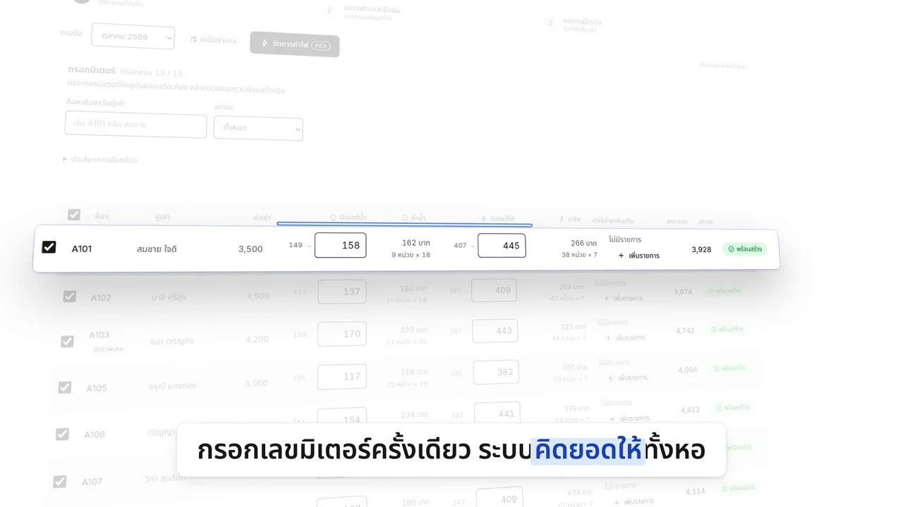
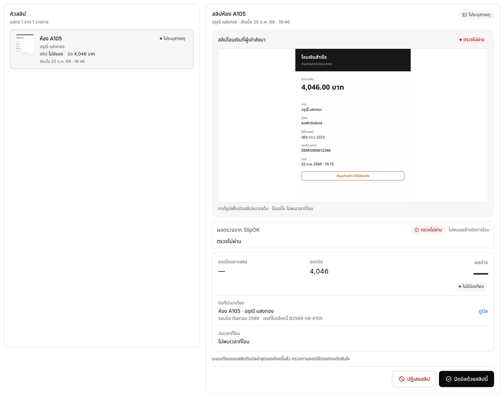
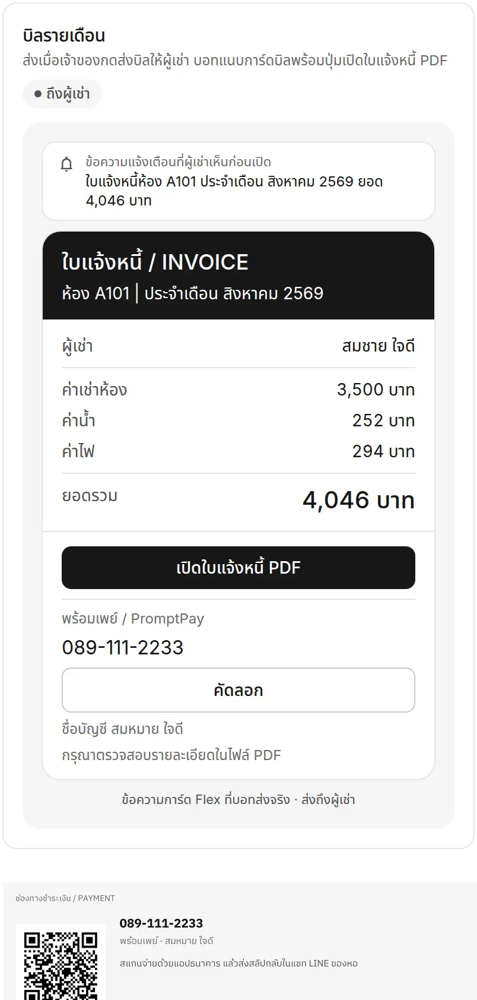

# Wang Chan Dorm

**จากสมุดจด สู่บิลที่ส่งเองทั้งหอ**

ระบบจัดการหอพักสำหรับเจ้าของคนเดียว — กรอกเลขมิเตอร์ครั้งเดียวแล้วออกบิลได้ทั้งหอ
ส่งเข้า LINE พร้อม QR พร้อมเพย์ยอดตรง และปิดบิลให้เองเมื่อผู้เช่าส่งสลิปการโอน
ผู้เช่าไม่ต้องติดตั้งแอปหรือจำรหัสอะไร แค่ส่งรูปสลิปในแชทของหอ

| | ลิงก์ |
|---|---|
| **ดูหน้าแนะนำโปรเจกต์** (`/welcome`) | https://wangchan-demo.nodhk2545.workers.dev/welcome |
| **ลองใช้ระบบจริง** ไม่ต้องสมัคร ไม่ต้องล็อกอิน | https://wangchan-demo.nodhk2545.workers.dev |

## ทำอะไรได้บ้าง

### เจ้าของหอ

- **ออกบิลทั้งหอในหน้าเดียว** — กรอกเลขมิเตอร์น้ำ/ไฟของทุกห้อง รองรับทั้งห้องคิดตามมิเตอร์และห้องเหมาจ่าย
  ระบบคิดยอดให้เอง แก้ค่าตั้งต้นทีหลังก็ไม่กระทบบิลเก่า เพราะบิลจำอัตราและเลขมิเตอร์ของวันที่ออกไว้
- **ใบแจ้งหนี้ PDF + QR พร้อมเพย์** — PDF ฟอนต์ไทยคมชัด คัดลอกข้อความได้ QR ตามมาตรฐาน EMVCo สแกนจ่ายผ่านแอปธนาคารได้เลย
- **ส่งบิลเข้า LINE ทีเดียวทั้งเดือน** — การ์ดใบแจ้งหนี้พร้อมปุ่มเปิด PDF และ QR บอกให้รู้ด้วยว่าใครยังไม่ได้เชื่อม LINE
- **ปิดบิลอัตโนมัติจากสลิป** — ผู้เช่าส่งรูปสลิป ระบบตรวจ เทียบยอดกับบิล แล้วปิดบิลให้เมื่อตรง
  สลิปหนึ่งใบปิดได้บิลเดียว กันสลิปซ้ำที่ระดับฐานข้อมูล
- **คิว "รอตรวจ"** — สลิปที่อ่านไม่ได้หรือยอดไม่ตรงมารวมกันพร้อมเหตุผลที่อ่านรู้เรื่อง
  แยกชัดว่า "ตรวจไม่ผ่าน" (สลิปมีปัญหา) ต่างจาก "ตรวจไม่ได้" (ระบบยังไม่ได้คำตอบ) เจ้าของจะรู้ว่าต้องทำอะไรต่อ
- **แดชบอร์ดเห็นทุกอย่างในหน้าเดียว** — ยอดที่ควรเก็บ เก็บแล้ว ค้างชำระ ห้องว่าง กราฟรายรับ 6 เดือน
  และผังสถานะทุกห้อง แยก "ยังไม่ออกบิล" ออกจาก "ค้างเงินงวดก่อน"
- **จัดการห้องและผู้เช่า** — ค่าเช่า อัตราน้ำไฟ ย้ายเข้า-ออก ค้นหาห้อง/ผู้เช่า/เบอร์โทรได้ทันที
- **ใช้ร่วมกันได้ในครอบครัว** — ข้อมูลผูกกับครอบครัว ไม่ใช่บัญชีเดียว มีสิทธิ์เจ้าของ/สมาชิก
- **อัปเดตสดทุกแท็บ** — บิลเปลี่ยนที่เครื่องหนึ่ง อีกเครื่องที่เปิดอยู่เห็นทันทีโดยไม่ต้องรีเฟรช
- **ธีมสว่าง/มืด** — สลับได้จากเมนูบัญชี

### ผู้เช่า

- **ไม่ต้องติดตั้งอะไร** — รับบิลและส่งสลิปในแชท LINE ของหอ
- **ลงทะเบียนเองผ่าน LINE** — กรอกชื่อ เบอร์ เลือกห้อง เจ้าของไม่ต้องคีย์ข้อมูลให้ และได้แจ้งเตือนเมื่อมีคนเข้าพักใหม่

## ลองเล่นในเดโม

เปิด https://wangchan-demo.nodhk2545.workers.dev — เข้าหอตัวอย่าง 18 ห้อง ผู้เช่า 15 คน พร้อมบิลย้อนหลัง

| เมนู | ลองทำอะไร |
|------|-----------|
| แดชบอร์ด | ดู KPI กราฟรายรับ และผังสถานะทุกห้อง |
| บิล | สร้างบิลทั้งหอ กรอกมิเตอร์ ดูยอดที่ระบบคิด แล้วเปิดใบแจ้งหนี้ PDF กับ QR |
| รอตรวจ | สลิปห้อง A105 รอตัดสินอยู่ ดูเหตุผลและลองปิดบิลเอง |
| ห้องพัก / ผู้เช่า | แก้ค่าเช่า อัตราน้ำไฟ ย้ายผู้เช่า |
| ตั้งค่า | ชื่อหอ บัญชีรับเงิน พร้อมเพย์ |

## สร้างด้วย

Cloudflare Workers · Hono · TypeScript · Cloudflare D1 + R2 + Durable Objects · React 19 · Vite · Tailwind CSS 4 ·
LINE Messaging API + LIFF · `pdf-lib` พร้อมฟอนต์ IBM Plex Sans Thai

Worker เดียวเสิร์ฟทั้ง API และหน้าเว็บ ยอดเงินทุกบาทคิดฝั่งเซิร์ฟเวอร์ ไม่เชื่อค่าที่ส่งมาจากเบราว์เซอร์

## License

สัญญาอนุญาตแยกตามไฟล์ — หน้า welcome, ทางเข้าเดโม และสื่อใน `public/welcome-media/` เป็น MIT
ส่วนที่เหลือ (ตรรกะของระบบหอพักและหน้าจอเจ้าของหอ) สงวนลิขสิทธิ์ ดู [LICENSE](LICENSE)
